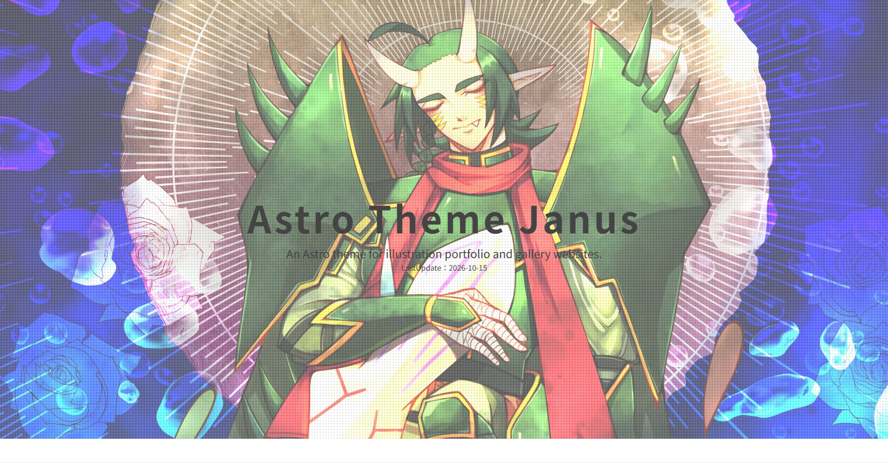
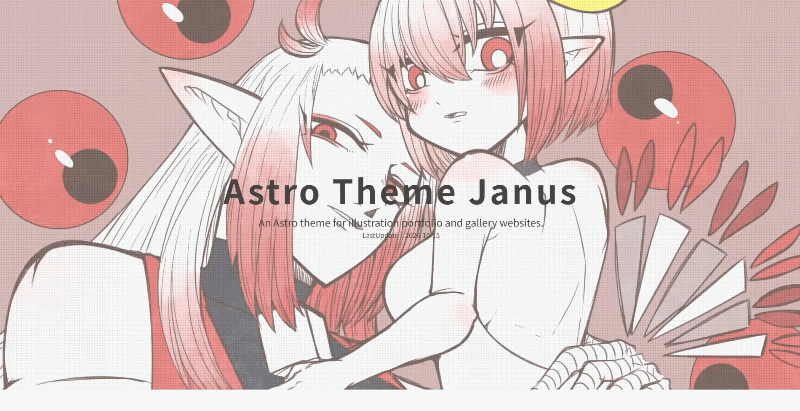
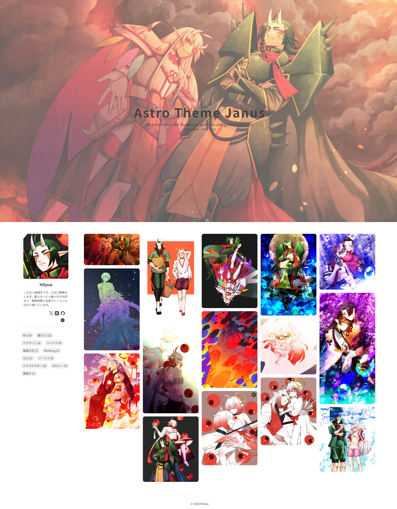

# Astro Theme Janus
絵描きが絵描きさんのために開発した、無料のポートフォリオ・イラストサイト用テーマ

[🖥️サンプルサイト](https://janus.hilavaarts.link/)

現在、マニュアルサイトを整備中です！

## ✨ 特徴

イラストレーターや二次創作勢のために設計された、モダンで快適な個人ギャラリー向けAstroテーマです。

- ⚡ **爆速＆軽量表示 (Astro v7)**
  - 不要なJavaScriptを削ぎ落とし、高解像度の画像ギャラリーでもストレスのない爆速ロードを実現
- 🏷️ **直感的なタグ・カテゴリ絞り込み**
  - キャラクター、カップリング、ジャンル別（例: 擬人化、CP名など）にワンクリックで作品を絞り込み可能
- 📚 **マンガ・まとめ投稿対応**
  - サムネイル上に枚数バッジを表示。複数ページのイラストにも最適
- 🛡️ **プラットフォーム非依存**
  - 外部SNSやホスティングの規約改定に脅かされない、自由で永続的な個人サイトを構築可能
- ☁️ **Cloudflare R2 × Sveltia CMS の連携**
  - 高解像度画像をR2に逃がすことで転送量無料＆高速配信
  - Gitやコードを意識せず、ブラウザ（Sveltia CMS）からSNS感覚で作品を投稿・管理
- 👤 **充実したプロフィール**
  - SNSリンク（X, pixiv, GitHub等）、サイト説明ポップアップを搭載

## 🚀Get Started
Use this templateからはじめてみましょう！

## 📷️スクリーンショット(サンプルサイト)
### ヒーローヘッダー

### トップページ

### 作品詳細ページ

## 🙏 技術スタック / 使用ライブラリ
- [Astro](https://astro.build/)
- [Astro Icon](https://www.astroicon.dev/)
- [Sveltia CMS](https://sveltiacms.app/en/)
- [PhotoSwipe](https://photoswipe.com/)
- [MiniMasonry.js](https://spope.github.io/MiniMasonry.js/)
- [Swiper](https://swiperjs.com/)

## 🐞 不具合・要望
不具合報告や機能要望は Issue よりお気軽にお知らせください。

## 📝 ライセンス
MIT License

## ⭐️ 最後に
このテーマが皆さんの創作活動のお役に立てれば嬉しいです。

## 🎨ToneFolio
Hilavaが開発したイラストサイト向けテーマです。こちらもよろしくお願いいたします！  
[GitHub](https://github.com/hilava999/tonefolio) | [サンプルサイト](https://tonefolio.hilavaarts.link/)

## 🛠️ 開発者情報
### Hilava
しがない絵描きです。たまに開発もします。創作とゲームとゲーム音楽が好き。  
テーマを使ってみてのご感想はWaveboxからお気軽にお寄せくださいね！  
[GitHub](https://github.com/hilava999) | [X](https://x.com/hilava_gkb) | [Wavebox](https://wavebox.me/wave/6f0sa4hla3csl7op/)
